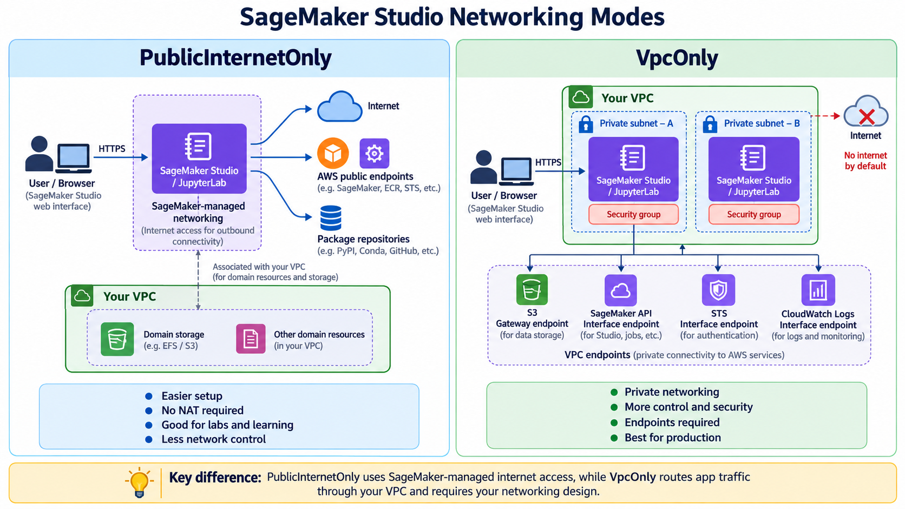

# AWS SageMaker LLMOps — repaired infrastructure

Terraform-managed SageMaker Studio **VPC-only** training lab with separate bootstrap, identity and Dev/QA/Prod deployment stacks. Deployment uses GitHub Actions OIDC and separate plan/apply roles.

**Start here: [Repair & deploy runbook](docs/REPAIR_AND_DEPLOY.md).**

- `terraform/bootstrap/`: S3 backend creation, local state for initial bootstrap.
- `terraform/identity/`: IAM roles, AWS read-only baseline, scoped backend policies, infrastructure apply policy. References the existing account-global GitHub OIDC provider rather than creating another one.
- `terraform/environments/dev/`: legacy flat Dev resource addresses retained for state continuity, plus KMS and Studio domain.
- `terraform/environments/qa|prod/`: independent region-specific module roots.
- `.github/workflows/terraform-validate.yml`: Terraform format and validation.
- `.github/workflows/terraform-infra-manual.yml`: manual deployment entry point.
- `.github/workflows/terraform-reusable-deploy.yml`: account check, state isolation, plan, approval-bound apply of saved plan.

**Do not apply blindly.** The original project had duplicate Dev resource declarations and an IAM bootstrap gap. The corrected code has not been applied against your AWS account; run the checks and inspect state and plans first. Studio and VPC endpoints incur AWS charges.

